# Arquitectura y diseño — descripción paso a paso

Este documento describe el sistema **de lo general a lo concreto**: primero el contexto y los
servicios, después la estructura interna del servicio de pedidos, el modelo de clases y de
entidades, y por último cada flujo paso a paso y el catálogo de clases y funciones.

Los diagramas están en [Mermaid](https://mermaid.js.org/) (GitHub los dibuja directamente). Los
nombres de clases, métodos, columnas y propiedades son los del código.
Los patrones de diseño aplicados están resumidos en [PATRONES.md](PATRONES.md).

Índice:

1. [Contexto del sistema](#1-contexto-del-sistema)
2. [Servicios y despliegue](#2-servicios-y-despliegue)
3. [Módulos del build](#3-módulos-del-build)
4. [Arquitectura hexagonal del servicio de pedidos](#4-arquitectura-hexagonal-del-servicio-de-pedidos)
5. [Diagramas de clases](#5-diagramas-de-clases)
6. [Modelo de entidades (base de datos)](#6-modelo-de-entidades-base-de-datos)
7. [Máquina de estados del pedido](#7-máquina-de-estados-del-pedido)
8. [Flujos paso a paso](#8-flujos-paso-a-paso)
9. [Resiliencia ante el proveedor](#9-resiliencia-ante-el-proveedor)
10. [Seguridad](#10-seguridad)
11. [Catálogo de clases y funciones](#11-catálogo-de-clases-y-funciones)
12. [Configuración](#12-configuración)
13. [Errores y códigos HTTP](#13-errores-y-códigos-http)
14. [Tests: qué verifica cada suite](#14-tests-qué-verifica-cada-suite)
15. [CI/CD y operación](#15-cicd-y-operación)

---

## 1. Contexto del sistema

**Qué resuelve.** Una empresa gestiona pedidos de sus clientes. Al **confirmar** un pedido hay
que pedir el **coste de envío** a un proveedor logístico externo que no controlamos: puede tardar
hasta 5 s, devuelve 503 de forma intermitente y exige un token.

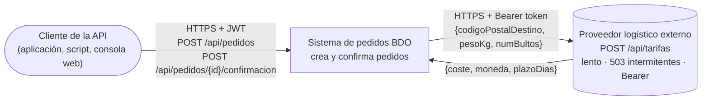

**Las dos operaciones del enunciado:**

| Operación | Qué hace |
|---|---|
| `POST /api/pedidos` | Crea el pedido con sus líneas **en una sola transacción**; los importes los calcula el servidor. |
| `POST /api/pedidos/{id}/confirmacion` | Pide la tarifa al proveedor, guarda el coste de envío y actualiza el total. |

---

## 2. Servicios y despliegue

### 2.1 Paso a paso: qué pieza hace qué

1. El **cliente** pide un token al **servidor de autorización** (`pedidos-auth`).
2. Llama al **API Gateway** (`pedidos-gateway`) con ese token. El gateway valida el JWT, aplica el
   límite de peticiones, asigna un `X-Correlation-Id` y enruta.
3. El gateway resuelve la dirección del servicio en el **registro Eureka** (`pedidos-registry`) y
   reenvía la petición.
4. El **servicio de pedidos** (`pedidos-api`) vuelve a validar el JWT, valida el cliente en el
   **servicio de clientes** (`pedidos-cliente`) y, al confirmar, llama al **proveedor logístico**.
5. Cada servicio de negocio tiene **su propia base de datos** (H2 en local, PostgreSQL en
   despliegue).
6. El **Config Server** (`pedidos-config`) sirve configuración centralizada y cifra secretos con
   JCE (los servicios todavía no lo importan; ver README).

### 2.2 Diagrama de despliegue

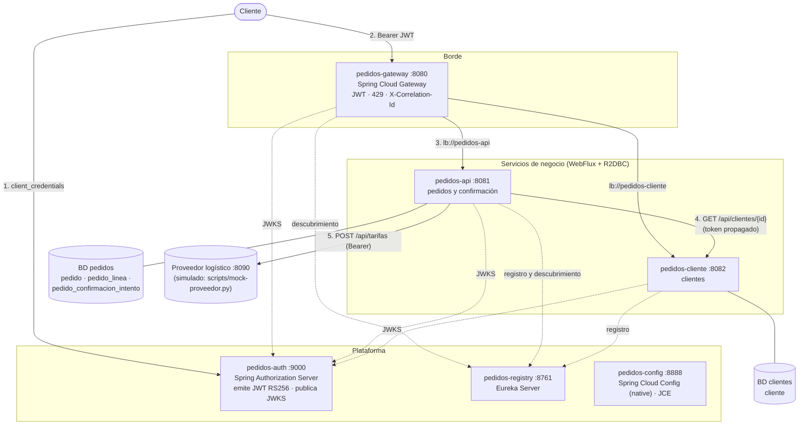

### 2.3 Puertos y datos de cada servicio

| Servicio | Puerto | Tecnología | Datos que posee |
|---|---:|---|---|
| `pedidos-gateway` | 8080 | Spring Cloud Gateway (WebFlux) | — |
| `pedidos-api` | 8081 | WebFlux + R2DBC + Resilience4j | `pedido`, `pedido_linea`, `pedido_confirmacion_intento` |
| `pedidos-cliente` | 8082 | WebFlux + R2DBC | `cliente` |
| `pedidos-auth` | 9000 | Spring Authorization Server (Servlet) | clientes OAuth en memoria |
| `pedidos-registry` | 8761 | Eureka Server | registro de instancias |
| `pedidos-config` | 8888 | Spring Cloud Config | `config-repo/` |
| proveedor simulado | 8090 | Python (`scripts/mock-proveedor.py`) | contadores de llamadas |

En `docker-compose.yml` cada servicio corre en un contenedor y PostgreSQL tiene dos bases de datos
(`pedidos` y `clientes`, creadas por `scripts/postgres-init.sh`).

---

## 3. Módulos del build

Proyecto Gradle multi-módulo (Java 21). Las versiones viven en `gradle/libs.versions.toml`.

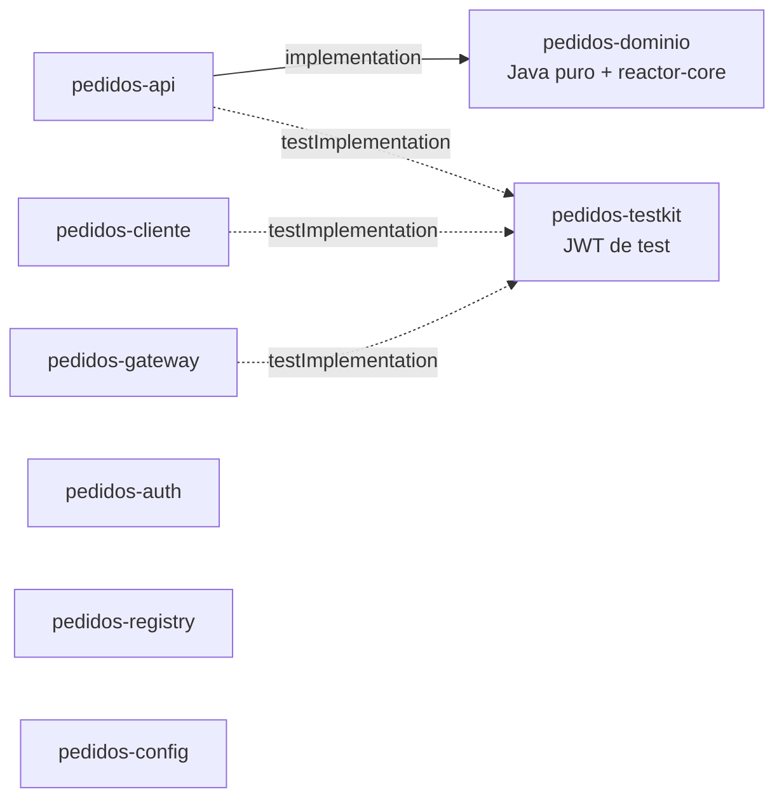

| Módulo | Contenido | Depende de Spring |
|---|---|---|
| `pedidos-dominio` | Entidades, objetos de valor, máquina de estados, cálculo de importes, puertos, errores | **No** (solo `reactor-core` para `Mono` en los puertos) |
| `pedidos-api` | Servicio de pedidos: web, aplicación, persistencia, adaptadores del proveedor y de clientes | Sí |
| `pedidos-cliente` | Servicio de clientes | Sí |
| `pedidos-gateway` | API Gateway | Sí |
| `pedidos-auth` | Servidor de autorización OAuth2 | Sí |
| `pedidos-registry` | Eureka | Sí |
| `pedidos-config` | Config Server | Sí |
| `pedidos-testkit` | `TokenDePrueba`: genera JWT HS256 reales para los tests | Solo `spring-security-oauth2-jose` |

**Por qué el dominio no depende de Spring:** las reglas de negocio (importes, estados) se prueban
con tests unitarios puros, en milisegundos, y la infraestructura se puede cambiar (WebClient o
RestTemplate, H2 o PostgreSQL) sin tocar el dominio.

---

## 4. Arquitectura hexagonal del servicio de pedidos

El servicio de pedidos sigue **puertos y adaptadores**. El dominio define **qué necesita**
(puertos); la infraestructura decide **cómo** (adaptadores).

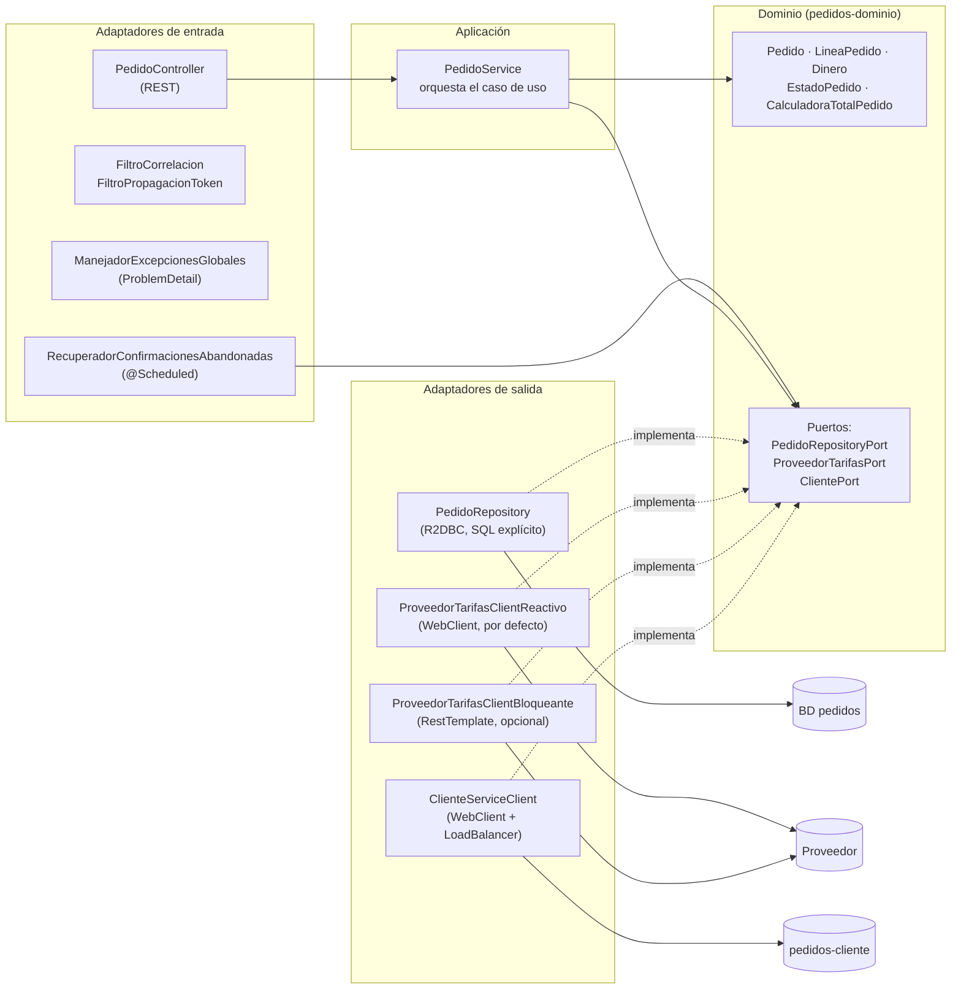

**Reglas de dependencia:**

* El controlador solo traduce HTTP ↔ dominio y delega en `PedidoService`. No tiene lógica.
* `PedidoService` decide **cuándo** se toca la base de datos y **cuándo** se llama al proveedor,
  pero no conoce SQL ni HTTP: usa los puertos.
* Las reglas (cálculo de importes, transiciones de estado) están en el dominio y en ningún otro
  sitio.
* Solo un adaptador del proveedor está activo, según `app.proveedor.modo` (`reactivo` por
  defecto, o `bloqueante`).

---

## 5. Diagramas de clases

### 5.1 Dominio: agregado, objetos de valor y servicio de dominio

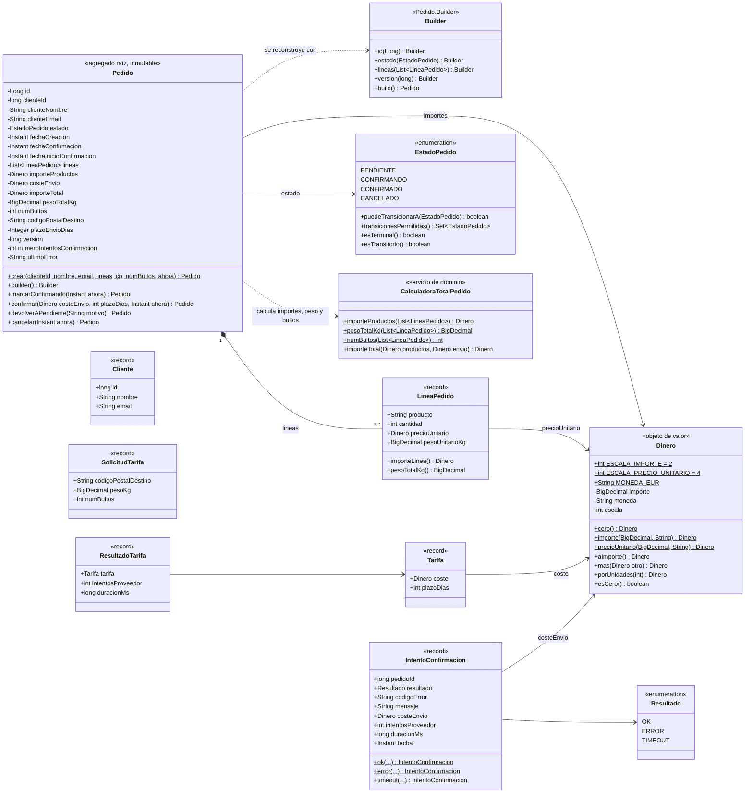

Claves del diseño del dominio:

* **`Pedido` es inmutable**: cada transición (`marcarConfirmando`, `confirmar`,
  `devolverAPendiente`, `cancelar`) devuelve un **pedido nuevo** y valida antes el estado de origen.
  Si no es el correcto, lanza `TransicionDeEstadoInvalidaException`.
* `importeProductos`, `pesoTotalKg` y `numBultos` se **derivan de las líneas** en el constructor
  (`CalculadoraTotalPedido`). El cliente no puede inyectarlos.
* `importeTotal` solo existe cuando hay `costeEnvio`: `Builder.build()` rechaza un total sin coste.
* `Dinero` lleva siempre la moneda y la escala; `mas()` rechaza sumar monedas distintas.

### 5.2 Puertos y adaptadores

```mermaid
classDiagram
    direction TB

    class PedidoRepositoryPort {
        <<interface>>
        +insertar(Pedido) Mono~Pedido~
        +buscarPorId(long) Mono~Pedido~
        +actualizarSiEstadoEs(long id, long versionEsperada, EstadoPedido estadoEsperado, Pedido) Mono~Boolean~
        +registrarIntento(IntentoConfirmacion) Mono~Void~
        +recuperarConfirmacionesAbandonadas(Instant limite) Mono~Integer~
    }

    class ProveedorTarifasPort {
        <<interface>>
        +calcularTarifa(SolicitudTarifa) Mono~ResultadoTarifa~
    }

    class ClientePort {
        <<interface>>
        +buscarPorId(long) Mono~Cliente~
    }

    class PedidoRepository {
        <<@Repository>>
        -DatabaseClient databaseClient
        +lineasDe(long pedidoId) Mono~List~
        -siguienteIdPedido() Mono~Long~
    }

    class PedidoMapper {
        <<utilidad>>
        +aBuilder(Row)$ Pedido.Builder
        +aLinea(Row)$ LineaPedido
        +conIdentificador(Pedido, long)$ Pedido
        +aTimestamp(Instant)$ OffsetDateTime
    }

    class ProveedorTarifasClientReactivo {
        <<@Component, modo=reactivo>>
        -WebClient webClient
        -CircuitBreaker circuitBreaker
        -RateLimiter rateLimiter
        -Bulkhead bulkhead
        -PoliticaEsperaReintentos esperas
        -traducirRespuesta(ClientResponse) Mono~Tarifa~
        -traducirErrorDeIntento(Throwable) Throwable
        -politicaDeReintentos(long inicio, Duration presupuesto) Retry
    }

    class ProveedorTarifasClientBloqueante {
        <<@Component, modo=bloqueante>>
        -RestTemplate restTemplate
        -Retry retry
        +politicaDeReintentos(ProveedorLogisticoProperties)$ RetryConfig
        -llamadaHttp(SolicitudTarifa) Tarifa
    }

    class ClasificadorFallosProveedor {
        <<utilidad>>
        +esReintentable(Throwable)$ boolean
        +traducirRechazo(Throwable)$ Throwable
        +conIntentos(Throwable, int)$ Throwable
    }

    class CuentaParaElCircuito {
        <<Predicate~Throwable~>>
        +test(Throwable) boolean
    }

    class PoliticaEsperaReintentos {
        +esperaAntesDe(Throwable causa, long reintento) Duration
    }

    class ProveedorTarifasMapper {
        <<utilidad>>
        +aTarifa(TarifaRespuesta)$ Tarifa
        +retryAfter(HttpHeaders, Clock)$ Integer
        +truncar(String, int)$ String
    }

    class TarifaRespuesta {
        <<record>>
        +BigDecimal coste
        +String moneda
        +Integer plazoDias
    }

    class ClienteServiceClient {
        <<@Component>>
        -WebClient webClient
        -CircuitBreaker circuitBreaker
        -traducirRespuesta(ClientResponse, long)$ Mono~ClienteResponse~
    }

    PedidoRepository ..|> PedidoRepositoryPort
    PedidoRepository ..> PedidoMapper
    ProveedorTarifasClientReactivo ..|> ProveedorTarifasPort
    ProveedorTarifasClientBloqueante ..|> ProveedorTarifasPort
    ProveedorTarifasClientReactivo ..> ClasificadorFallosProveedor
    ProveedorTarifasClientBloqueante ..> ClasificadorFallosProveedor
    ProveedorTarifasClientReactivo ..> PoliticaEsperaReintentos
    ProveedorTarifasClientBloqueante ..> PoliticaEsperaReintentos
    ProveedorTarifasClientReactivo ..> ProveedorTarifasMapper
    ProveedorTarifasClientBloqueante ..> ProveedorTarifasMapper
    ProveedorTarifasMapper ..> TarifaRespuesta
    ClasificadorFallosProveedor ..> CuentaParaElCircuito : clase anidada
    ClienteServiceClient ..|> ClientePort
```

### 5.3 Web y aplicación

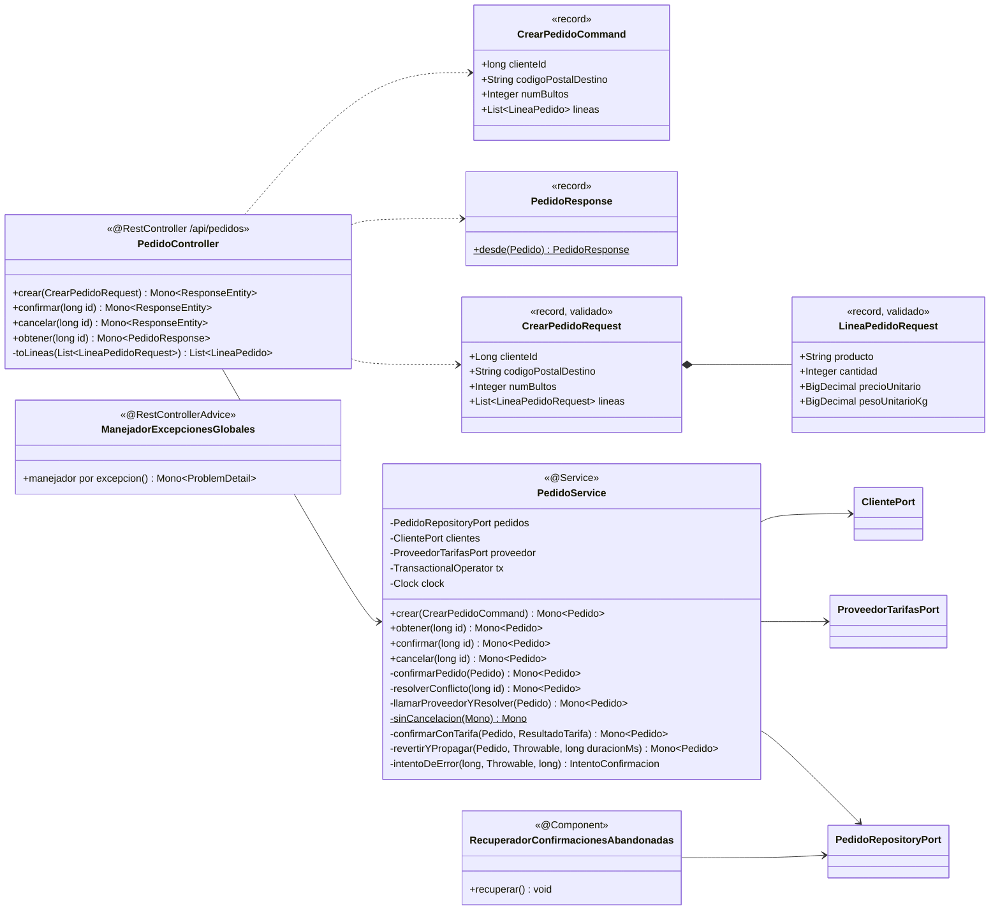

### 5.4 Jerarquía de errores

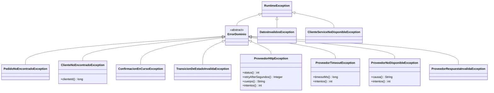

`ProveedorNoDisponibleException.causa()` vale `ERROR_CONEXION`, `CIRCUITO_ABIERTO`, `RATE_LIMIT` o
`BULKHEAD`. `ClienteServiceNoDisponibleException` vive en `pedidos-api` (es un fallo de
infraestructura, no de negocio).

### 5.5 Servicio de clientes, gateway y autorización

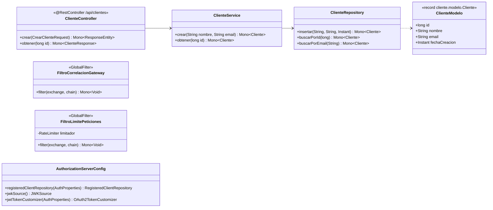

---

## 6. Modelo de entidades (base de datos)

### 6.1 Diagrama entidad-relación

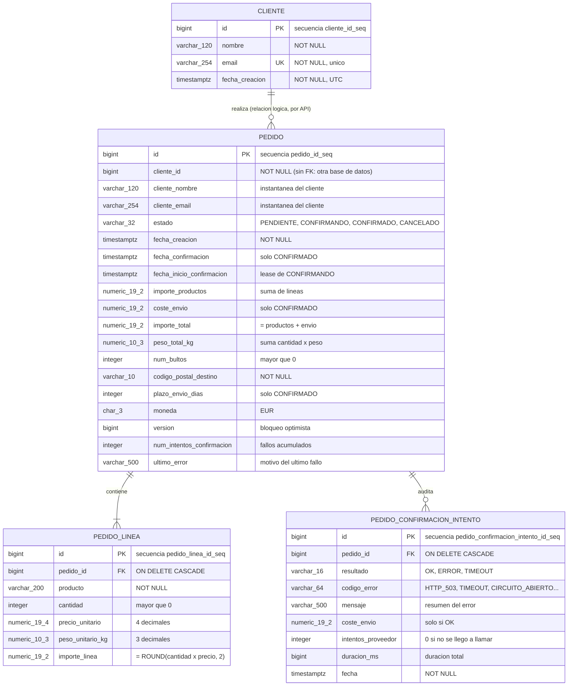

### 6.2 Por qué así

* **Cliente y pedido están en bases de datos distintas** (un microservicio por dato): no hay clave
  foránea `pedido.cliente_id → cliente.id`. La integridad la garantiza la API: al crear un pedido
  se consulta el cliente y se guarda una **instantánea** de nombre y email.
* **Identificadores con secuencia** (`nextval`): la aplicación reserva el id antes del `INSERT`
  (H2 no admite `INSERT ... RETURNING`).
* **`version`** es el bloqueo optimista: cada transición hace `version = version + 1`.
* **`pedido_confirmacion_intento`** es la auditoría: responde "qué pasó con este pedido" sin logs.

### 6.3 Restricciones de integridad (`CHECK`)

Las invariantes del dominio se repiten en la base de datos: un SQL escrito a mano tampoco puede
dejar un pedido incoherente.

| Restricción | Regla |
|---|---|
| `ck_pedido_estado` | `estado` ∈ {PENDIENTE, CONFIRMANDO, CONFIRMADO, CANCELADO} |
| `ck_pedido_confirmado_completo` | `CONFIRMADO` ⇒ coste, total, plazo y fecha de confirmación no nulos |
| `ck_pedido_sin_total_si_no_confirmado` | otro estado ⇒ sin coste ni total |
| `ck_pedido_total_cuadra` | `importe_total = importe_productos + coste_envio` |
| `ck_pedido_confirmando_con_lease` | `CONFIRMANDO` ⇒ `fecha_inicio_confirmacion` no nula |
| `ck_pedido_bultos`, `ck_pedido_peso`, `ck_pedido_*` | bultos > 0; importes, peso, plazo, versión e intentos ≥ 0 |
| `ck_pedido_linea_importe` | `importe_linea = ROUND(cantidad × precio_unitario, 2)` |
| `ck_pedido_linea_cantidad` | cantidad > 0 |
| `ck_intento_coste` | resultado `OK` ⇔ hay coste de envío |
| `ck_intento_intentos` | intentos ≥ 0 |
| `uk_cliente_email` | email único |

Ficheros: `db/postgresql/esquema.sql` (consolidado), `pedidos-api/.../db/schema.sql` y
`pedidos-cliente/.../db/schema.sql` (uno por servicio; `scripts/probar-postgresql.sh` comprueba que
son idénticos al consolidado), `db/postgresql/datos-prueba.sql` (10 filas por tabla) y
`db/postgresql/verificacion.sql`.

---

## 7. Máquina de estados del pedido

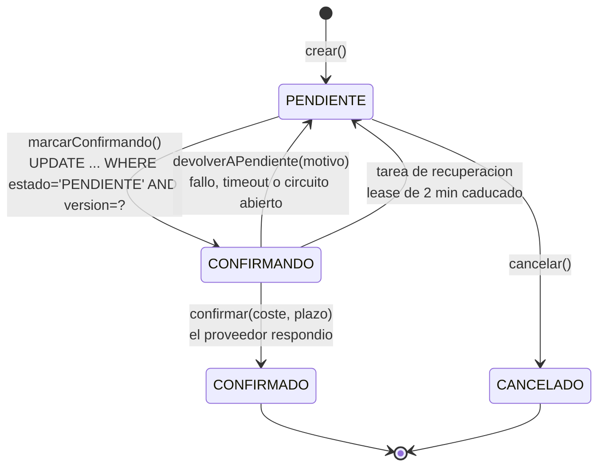

| Estado | Significado | Se puede |
|---|---|---|
| `PENDIENTE` | Creado, sin coste de envío | confirmar, cancelar |
| `CONFIRMANDO` | Una petición "tiene" el pedido y está llamando al proveedor | nada (otra confirmación → 409) |
| `CONFIRMADO` | Tiene coste, plazo y total. **Terminal** | confirmar de nuevo → 200 idempotente |
| `CANCELADO` | Cerrado por el cliente. **Terminal** | nada (→ 409) |

`EstadoPedido` contiene la tabla de transiciones y `Pedido.exigirEstado()` la aplica en cada
transición. `CONFIRMANDO` existe para la **exclusión mutua**: pasar de `PENDIENTE` a `CONFIRMANDO`
es la operación atómica que solo una petición puede ganar.

---

## 8. Flujos paso a paso

### 8.1 Crear un pedido (`POST /api/pedidos`)

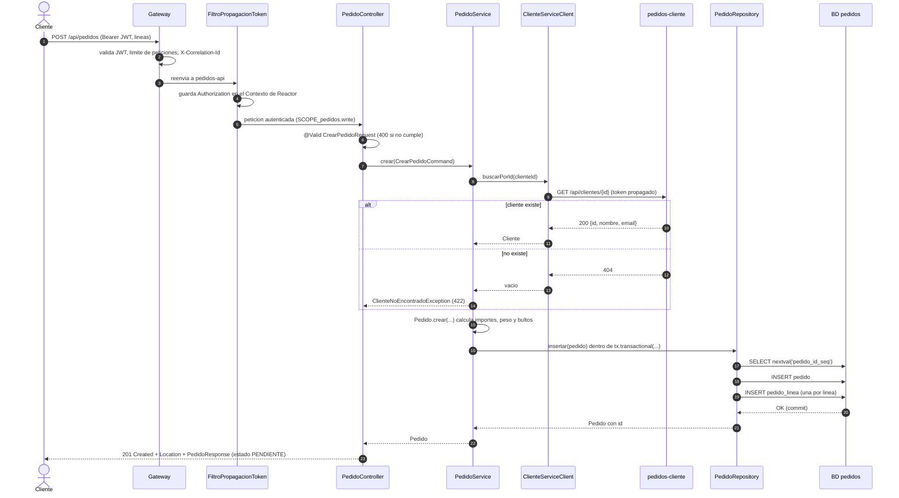

Pasos clave:

1. **Validación de entrada** (`CrearPedidoRequest`): cliente positivo, al menos una línea,
   cantidades 1–10000, precios con 4 decimales como máximo, pesos con 3.
2. **No hay campos de importe** en la petición: si el cliente envía `importeTotal`, Jackson lo
   ignora.
3. **El cliente debe existir** (servicio de clientes). Su nombre y email se congelan en el pedido.
4. **Cálculo en el dominio**: `importe_linea = ROUND(cantidad × precio, 2, HALF_UP)`,
   `importe_productos = Σ importe_linea`, `peso = Σ cantidad × peso_unitario`,
   `bultos = Σ cantidad` (o el valor declarado).
5. **Una sola transacción** para el pedido y sus líneas: si falla una línea, no queda nada.

### 8.2 Confirmar un pedido: camino feliz

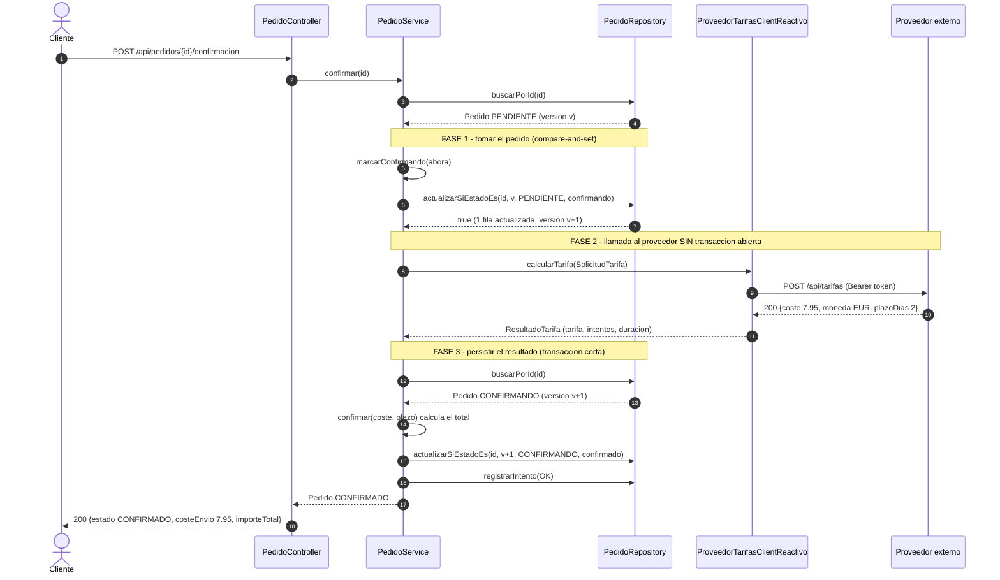

Por qué tres fases: una transacción abierta durante los hasta 5 s del proveedor retendría una
conexión del pool por cada confirmación en curso. Con tres fases cortas, la base de datos solo se
usa unos milisegundos en cada extremo.

Las fases 2 y 3 se ejecutan con `sinCancelacion(...)`: si el cliente HTTP cierra la conexión a
mitad, la operación **termina igualmente** y el pedido no queda en `CONFIRMANDO`.

### 8.3 Dos confirmaciones simultáneas

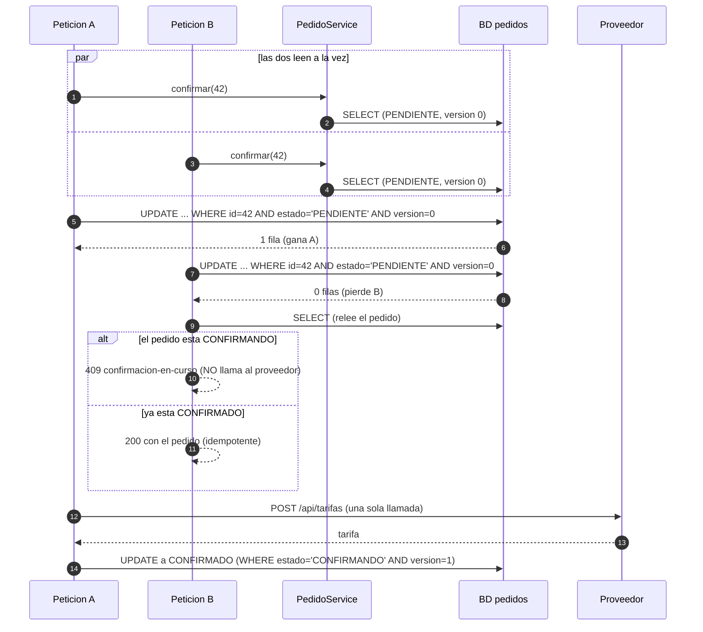

* La atomicidad la da **el motor de base de datos** (una sola sentencia `UPDATE` condicional), no
  un `synchronized` (que no funcionaría entre varias instancias del servicio).
* No hay `SELECT ... FOR UPDATE`: bloquearía la fila durante toda la llamada al proveedor.

### 8.4 El proveedor falla: reintentos y reversión

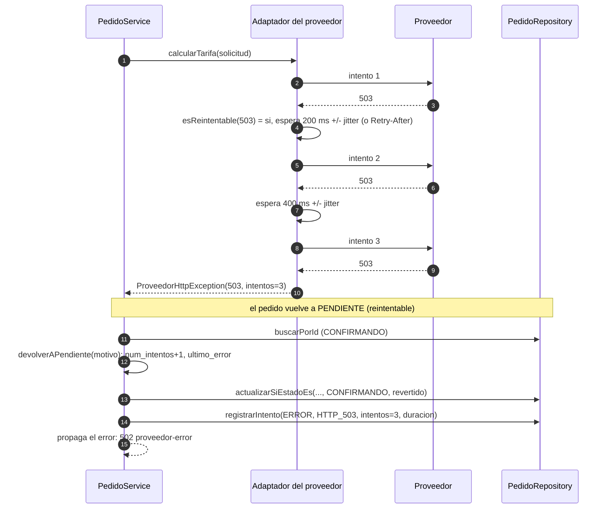

Variantes del mismo flujo:

| El proveedor... | Reintentos | Respuesta | Intento auditado |
|---|---|---|---|
| tarda más de 6 s | ninguno | 504 | `TIMEOUT` |
| responde 400 | ninguno | 502 | `ERROR`, `HTTP_400` |
| responde 200 vacío o JSON inválido | ninguno | 502 | `ERROR` |
| no acepta conexiones | hasta 3 | 503 | `ERROR`, `ERROR_CONEXION` |
| tiene el circuito abierto | 0 llamadas | 503 | `ERROR`, `CIRCUITO_ABIERTO`, 0 intentos |
| pide `Retry-After` mayor que el presupuesto | ninguno | 502 | `ERROR`, `HTTP_503` |

En todos los casos el pedido termina en `PENDIENTE`, con `ultimoError` y una fila de auditoría.

### 8.5 Recuperación de confirmaciones abandonadas

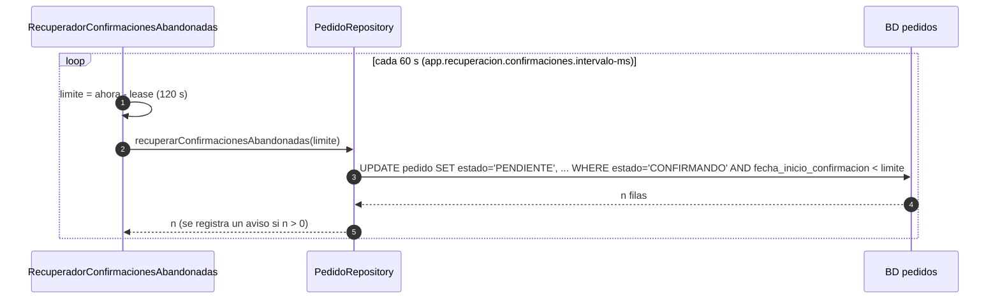

Cubre el caso en que el **proceso muere** entre la fase 1 y la fase 3 (despliegue, caída del
nodo). El *lease* (2 min) es muy superior al peor caso de una confirmación (8 s de presupuesto más
la persistencia), de modo que nunca se roba un pedido que se está confirmando.

### 8.6 Obtener un token y llamar a la API

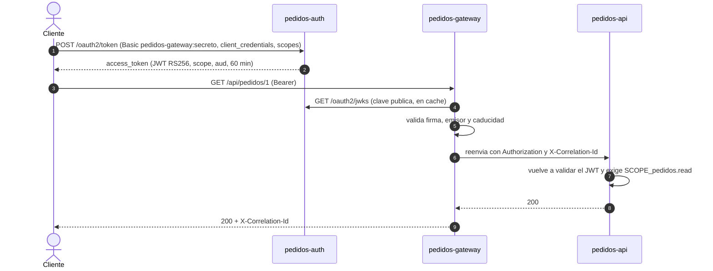

---

## 9. Resiliencia ante el proveedor

### 9.1 La cadena de protección

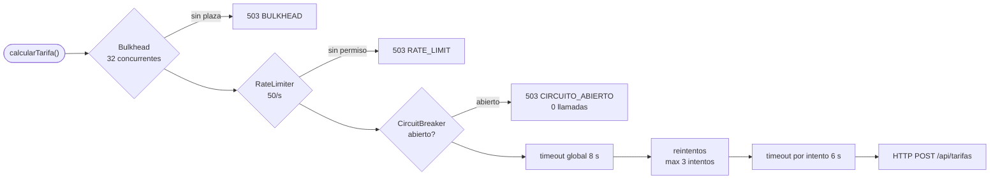

* **De fuera hacia dentro**: si no hay plaza o permiso se rechaza **sin llamar** y sin contar como
  fallo del proveedor.
* **El circuito envuelve a los reintentos**: cuenta una petición de negocio, no cada intento.
* **El presupuesto global** (8 s) incluye todos los intentos y las esperas: es lo máximo que espera
  el cliente.

### 9.2 Cómo se clasifica cada fallo

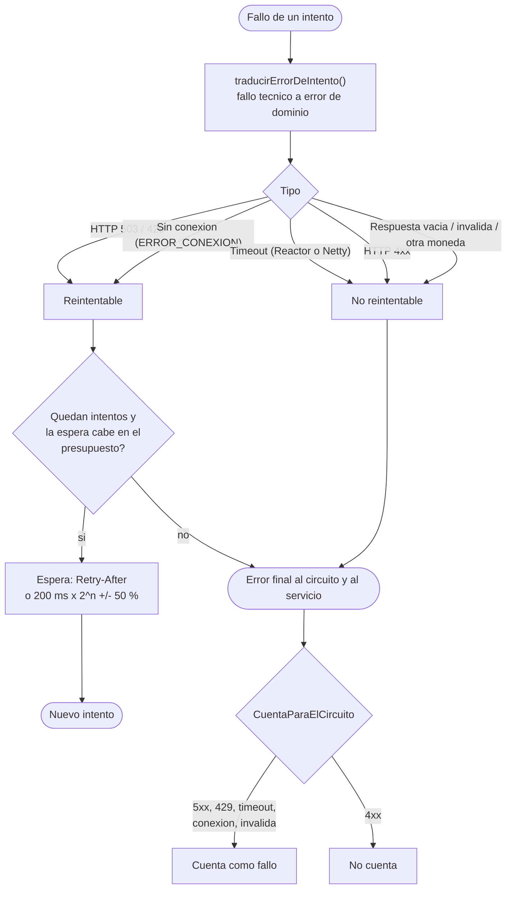

Una sola clase decide estas reglas para los dos adaptadores: `ClasificadorFallosProveedor`
(`esReintentable` y el predicado `CuentaParaElCircuito`, enlazado desde `record-failure-predicate`
en el YAML).

### 9.3 Valores

| Parámetro | Valor | Propiedad |
|---|---|---|
| Timeout de conexión | 1 s | `app.proveedor.connect-timeout` |
| Timeout por intento | 6 s | `app.proveedor.timeout-por-intento` |
| Presupuesto global | 8 s | `app.proveedor.timeout-global` |
| Intentos | 3 | `app.proveedor.max-intentos` |
| Espera inicial / multiplicador / jitter | 200 ms / 2 / ±50 % | `app.proveedor.backoff-*` |
| `Retry-After` máximo | 60 s | `ProveedorTarifasMapper.RETRY_AFTER_MAXIMO_SEGUNDOS` |
| Circuito | ventana 20, mínimo 10, 50 % fallos, 30 s abierto, lenta > 5 s | `resilience4j.circuitbreaker.instances.proveedorLogistico` |
| Limitador | 50 peticiones/s, sin espera | `resilience4j.ratelimiter.instances.proveedorLogistico` |
| Bulkhead | 32 llamadas concurrentes, sin espera | `resilience4j.bulkhead.instances.proveedorLogistico` |
| Timeout de respuesta de Netty | timeout por intento + 1 s (última defensa) | `ProveedorLogisticoConfig` |

---

## 10. Seguridad

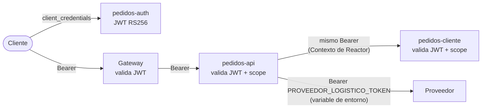

| Aspecto | Cómo |
|---|---|
| Emisión de tokens | `pedidos-auth` firma JWT RS256 y publica `/oauth2/jwks` |
| Validación | Gateway **y** cada microservicio (defensa en profundidad) |
| Permisos | Por *scope*: `pedidos.read`, `pedidos.write`, `clientes.read`, `clientes.write` |
| Entre servicios | Se propaga el token del cliente final (`FiltroPropagacionToken`) |
| Token del proveedor | `PROVEEDOR_LOGISTICO_TOKEN` en el entorno; `@NotBlank`: sin él no arranca |
| Secretos OAuth | Del entorno, guardados cifrados (*delegating password encoder*) |
| Rutas expuestas | Solo las declaradas en el gateway (sin rutas automáticas por servicio) |
| Errores | 500 genérico sin detalles internos; el detalle va al log |

---

## 11. Catálogo de clases y funciones

### 11.1 `pedidos-dominio`

| Clase | Función | Qué hace |
|---|---|---|
| `Pedido` | `crear(...)` | Crea un pedido `PENDIENTE`; deriva importes, peso y bultos de las líneas |
| | `marcarConfirmando(ahora)` | `PENDIENTE` → `CONFIRMANDO`; fija el inicio del *lease* y limpia el último error |
| | `confirmar(coste, plazo, ahora)` | `CONFIRMANDO` → `CONFIRMADO`; calcula `importeTotal` |
| | `devolverAPendiente(motivo)` | `CONFIRMANDO` → `PENDIENTE`; suma un intento fallido y guarda el motivo |
| | `cancelar(ahora)` | `PENDIENTE` → `CANCELADO` |
| `Pedido.Builder` | `build()` | Reconstruye un pedido (desde BD o en una transición) validando sus invariantes |
| `LineaPedido` | `importeLinea()` | `cantidad × precio`, redondeado a céntimos HALF_UP |
| | `pesoTotalKg()` | `cantidad × peso unitario` |
| `Dinero` | `importe(v, m)` / `precioUnitario(v, m)` | Crea un importe (2 decimales) o un precio (4); rechaza nulos, negativos o exceso de decimales |
| | `mas(otro)` | Suma exacta; rechaza monedas distintas |
| | `porUnidades(n)` / `aImporte()` | Multiplica por unidades / redondea a céntimos |
| `EstadoPedido` | `puedeTransicionarA(d)`, `esTerminal()`, `esTransitorio()` | Tabla de transiciones |
| `CalculadoraTotalPedido` | `importeProductos`, `pesoTotalKg`, `numBultos`, `importeTotal` | Cálculos puros sobre las líneas |
| `IntentoConfirmacion` | `ok`, `error`, `timeout` | Construye la fila de auditoría (acepta 0 intentos) |
| `SolicitudTarifa`, `Tarifa`, `ResultadoTarifa`, `Cliente` | constructores | Objetos de valor validados |
| Puertos | `PedidoRepositoryPort`, `ProveedorTarifasPort`, `ClientePort` | Contratos reactivos con la infraestructura |

### 11.2 `pedidos-api`

| Clase | Función | Qué hace |
|---|---|---|
| `PedidoController` | `crear`, `confirmar`, `cancelar`, `obtener` | Traduce HTTP ↔ dominio y delega en `PedidoService` |
| `PedidoService` | `crear(orden)` | Valida el cliente, crea el pedido e inserta en una transacción |
| | `confirmar(id)` | Idempotente si ya está confirmado; 409 si está en curso o cancelado; si no, confirma en tres fases |
| | `cancelar(id)` | Cancela con compare-and-set (409 si ya no está `PENDIENTE`) |
| | `confirmarPedido` | Fase 1: `actualizarSiEstadoEs(..., PENDIENTE, ...)` |
| | `resolverConflicto` | La petición que pierde relee: 200 si ya está confirmado, 409 si está en curso |
| | `llamarProveedorYResolver` | Fase 2: llama al proveedor y mide la duración |
| | `sinCancelacion` | Ejecuta las fases 2 y 3 hasta el final aunque el cliente HTTP cancele |
| | `confirmarConTarifa` | Fase 3: confirma y registra el intento OK en una transacción |
| | `revertirYPropagar` | Ante un fallo, devuelve a `PENDIENTE`, audita y propaga el error |
| `PedidoRepository` | `insertar` | `nextval` + `INSERT` del pedido y de sus líneas |
| | `buscarPorId` | Lee el pedido (dentro del *callback* de R2DBC) y después sus líneas |
| | `actualizarSiEstadoEs` | `UPDATE ... WHERE id=? AND estado=? AND version=?`; `true` si actualizó una fila |
| | `registrarIntento` | `INSERT` en la auditoría (nulos como `NULL`) |
| | `recuperarConfirmacionesAbandonadas` | `UPDATE` de los `CONFIRMANDO` con el *lease* caducado |
| `PedidoMapper` | `aBuilder`, `aLinea`, `conIdentificador`, `aTimestamp` | Filas ↔ dominio; instantes en UTC |
| `ProveedorTarifasClientReactivo` | `calcularTarifa` | WebClient con la cadena de resiliencia completa (§9) |
| | `traducirRespuesta` | 2xx → tarifa (vacío → inválida); otro código → `ProveedorHttpException` |
| | `traducirErrorDeIntento` | Timeout, conexión, JSON inválido → error de dominio |
| | `politicaDeReintentos` | `Retry.from`: reintentables, máximo de intentos y presupuesto |
| `ProveedorTarifasClientBloqueante` | `calcularTarifa`, `politicaDeReintentos` | RestTemplate en `boundedElastic`, misma política con `RetryConfig` |
| `ClasificadorFallosProveedor` | `esReintentable`, `CuentaParaElCircuito`, `traducirRechazo`, `conIntentos` | Reglas comunes de reintento y circuito |
| `PoliticaEsperaReintentos` | `esperaAntesDe(causa, n)` | `Retry-After` o backoff exponencial con jitter |
| `ProveedorTarifasMapper` | `aTarifa`, `retryAfter`, `truncar` | Valida el contrato del proveedor y lee `Retry-After` |
| `ClienteServiceClient` | `buscarPorId` | `GET /api/clientes/{id}`: 200 → cliente, 404 → vacío, otro → 503; con circuito y timeout |
| `FiltroCorrelacion` | `filter` | Asigna o valida `X-Correlation-Id`, lo devuelve y lo pone en el Contexto de Reactor |
| `FiltroPropagacionToken` | `filter` | Guarda el `Authorization` de entrada en el Contexto de Reactor |
| `ManejadorExcepcionesGlobales` | un `@ExceptionHandler` por error | Errores → `ProblemDetail` (§13) |
| `RecuperadorConfirmacionesAbandonadas` | `recuperar()` | Tarea programada de §8.5 |
| `ProveedorLogisticoConfig` | `webClientProveedor`, `circuitBreakerProveedor`, `rateLimiterProveedor`, `bulkheadProveedor`, `retryProveedor`, `restTemplateProveedor` | Beans del proveedor |
| `ClienteServiceConfig` | `webClientClientes` | WebClient con o sin balanceo de carga |
| `SecurityConfig` | `securityWebFilterChain` | Resource Server JWT y permisos por ruta |

### 11.3 Otros módulos

| Clase | Función | Qué hace |
|---|---|---|
| `ClienteController` | `crear`, `obtener` | Alta (`201`) y consulta de clientes |
| `ClienteService` | `crear`, `obtener` | Comprueba el email antes de insertar; 404 si no existe |
| `ClienteRepository` | `insertar`, `buscarPorId`, `buscarPorEmail` | SQL explícito; reserva el id antes del `INSERT` |
| `ManejadorExcepcionesGlobales` (clientes) | `claveDuplicada` | Una alta en carrera con el mismo email → 409 (restricción única) |
| `FiltroCorrelacion` (gateway) | `filter` | Genera el id si falta y lo reenvía al microservicio |
| `FiltroLimitePeticiones` | `filter` | 429 + `Retry-After: 1` si no hay permiso (200/s por instancia) |
| `AuthorizationServerConfig` | `registeredClientRepository`, `jwkSource`, `jwtTokenCustomizer`, `userDetailsService` | Clientes OAuth, clave RSA, claims `aud`/`azp`/`scope` |
| `TokenDePrueba` | `token(permisos...)` | JWT HS256 real para los tests de integración |

---

## 12. Configuración

| Propiedad | Por defecto | Para qué |
|---|---|---|
| `PROVEEDOR_LOGISTICO_URL` | `http://localhost:8090/api/tarifas` | Endpoint del proveedor |
| `PROVEEDOR_LOGISTICO_TOKEN` | — (obligatorio) | Token Bearer del proveedor |
| `PROVEEDOR_LOGISTICO_MODO` | `reactivo` | `reactivo` (WebClient) o `bloqueante` (RestTemplate) |
| `app.proveedor.*` | ver §9.3 | Timeouts, intentos y backoff |
| `app.clientes.url` / `load-balanced` / `timeout` | `http://pedidos-cliente` / `true` / `2s` | Servicio de clientes |
| `app.recuperacion.confirmaciones.lease-ms` / `intervalo-ms` | `120000` / `60000` | Recuperación de §8.5 |
| `SPRING_PROFILES_ACTIVE` | — | `eureka` (descubrimiento), `postgres` (PostgreSQL) |
| `SPRING_R2DBC_URL` / `USERNAME` / `PASSWORD` | H2 en memoria | Base de datos |
| `AUTH_ISSUER_URI`, `AUTH_JWKS_URI` | `http://localhost:9000...` | Validación de JWT |
| `AUTH_CLIENT_SECRET_GATEWAY`, `AUTH_USUARIO_PASSWORD` | — (obligatorios) | Secretos del servidor de autorización |
| `EUREKA_URL` | `http://localhost:8761/eureka/` | Registro |
| `CONFIG_ENCRYPT_KEY` | — | Clave JCE del Config Server |

`ProveedorLogisticoProperties` valida al arrancar que el presupuesto global sea ≥ al timeout por
intento y que el backoff tenga valores con sentido.

---

## 13. Errores y códigos HTTP

Todas las respuestas de error son `ProblemDetail` (RFC 9457) con `type`
`https://bdo.es/pedidos/problemas/<tipo>`.

| Excepción | HTTP | `type` |
|---|---:|---|
| `WebExchangeBindException` (validación) | 400 | `peticion-invalida` (con `errores[]` por campo) |
| `ResponseStatusException` (JSON mal formado, id no numérico) | 400 | `error` |
| sin token / sin permiso | 401 / 403 | (Spring Security) |
| `PedidoNoEncontradoException` | 404 | `pedido-no-encontrado` |
| `ConfirmacionEnCursoException` | 409 | `confirmacion-en-curso` |
| `TransicionDeEstadoInvalidaException` | 409 | `transicion-de-estado-invalida` |
| `ClienteNoEncontradoException` | 422 | `cliente-no-encontrado` |
| `DatosInvalidosException` (regla de dominio) | 422 | `datos-invalidos` |
| `ProveedorHttpException`, `ProveedorRespuestaInvalidaException` | 502 | `proveedor-error` (+ `codigoProveedor`, `intentos`) |
| `ProveedorNoDisponibleException` | 503 | `proveedor-no-disponible` |
| `ClienteServiceNoDisponibleException` | 503 | `servicio-clientes-no-disponible` |
| `ProveedorTimeoutException` | 504 | `proveedor-timeout` |
| cualquier otra | 500 | `error-interno` (sin detalles internos) |

---

## 14. Tests: qué verifica cada suite

```mermaid
flowchart BT
    u["Unitarios<br/>dominio (50) + PedidoService (13)"]
    i["Integracion<br/>WireMock (proveedor, clientes), H2 real,<br/>servidor real con JWT real (gateway, APIs)"]
    db["Base de datos real<br/>scripts/probar-postgresql.sh"]
    e2e["Extremo a extremo<br/>scripts/verificar-e2e.sh (H2 o PostgreSQL)"]
    u --> i --> db --> e2e
```

| Suite | Nivel | Qué verifica |
|---|---|---|
| `CalculadoraTotalPedidoTest` | unitario | Total, HALF_UP por línea, suma exacta de céntimos, monedas, peso y bultos |
| `PedidoTest`, `EstadoPedidoTest`, `ValoresDelDominioTest`, `ExcepcionesDelDominioTest` | unitario | Transiciones, invariantes y objetos de valor |
| `PedidoServiceTest` | unitario | Las tres fases, conflictos (409), idempotencia, reversión, circuito abierto, cancelación de la petición |
| `PedidoRepositoryTest` | integración (H2) | Inserción y lectura, compare-and-set, recuperación |
| `ProveedorTarifasClientReactivoTest` | integración (WireMock) | Contrato exacto, 503 reintentado, 400 no, timeouts (Reactor y Netty), conexión, `Retry-After`, respuestas inválidas, qué abre el circuito |
| `ProveedorTarifasClientBloqueanteTest` | integración (WireMock) | El mismo comportamiento con RestTemplate |
| `ClienteServiceClientTest` | integración (WireMock) | 200, 404 con cuerpo → vacío, 5xx y timeout → 503, token propagado |
| `PedidoControllerTest` | integración (API real) | Flujo completo, validación, 502, auditoría, 2 y 10 confirmaciones simultáneas, predicado del circuito |
| `PedidoControllerTimeoutTest` | integración (API real) | 504 y el pedido vuelve a `PENDIENTE` |
| `PedidoControllerModoBloqueanteTest` | integración (API real) | La aplicación funciona con `app.proveedor.modo=bloqueante` |
| `ClienteApiIntegrationTest` | integración (API real) | Alta, 404, email duplicado (también en carrera), validación, permisos |
| `GatewayIntegrationTest`, `GatewayLimitePeticionesTest` | integración (gateway real) | 401 antes de enrutar, correlación, sin rutas automáticas, 429 |

---

## 15. CI/CD y operación

```mermaid
flowchart LR
    a["Checkout"] --> b["Build<br/>(sin tests)"] --> c["Esquema PostgreSQL<br/>probar-postgresql.sh"] --> d["Tests<br/>+ informe JUnit"] --> e["Cobertura<br/>JaCoCo"] --> f["SonarQube<br/>./gradlew sonar"] --> g["Empaquetado<br/>bootJar"] --> h["Imagenes Docker<br/>bdo/servicio:1.0.0-N"] --> i["E2E<br/>verificar-e2e.sh"]
```

* **Jenkinsfile**: pipeline declarativo con las etapas del diagrama. El token del proveedor llega
  de una credencial de Jenkins (`bdo-proveedor-token`).
* **Sonar**: configurado en `build.gradle.kts` (bloque `sonar`) con la cobertura de JaCoCo.
* **Docker**: `Dockerfile` multi-etapa (JDK 21 para compilar, JRE 21 para ejecutar, usuario sin
  privilegios, *healthcheck* sin herramientas extra). `docker-compose.yml` levanta los servicios,
  PostgreSQL (puerto 55432 en la máquina) y el proveedor simulado.
* **Observabilidad**: Actuator (`health` con *probes*, `info`, `metrics`) y `X-Correlation-Id`
  extremo a extremo en las cabeceras.
